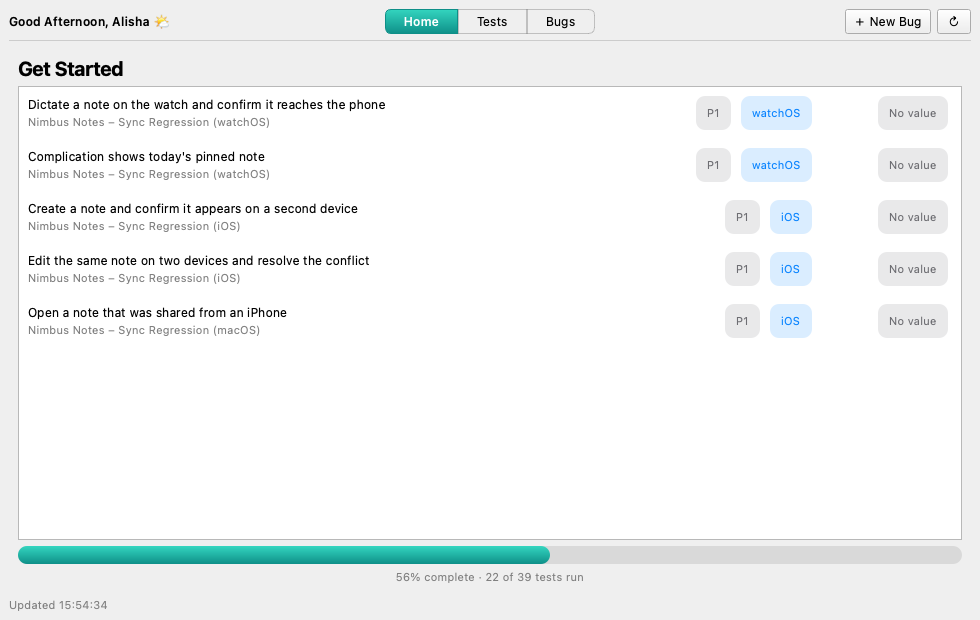
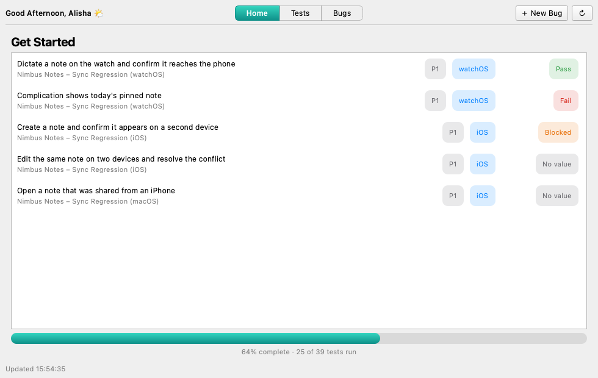
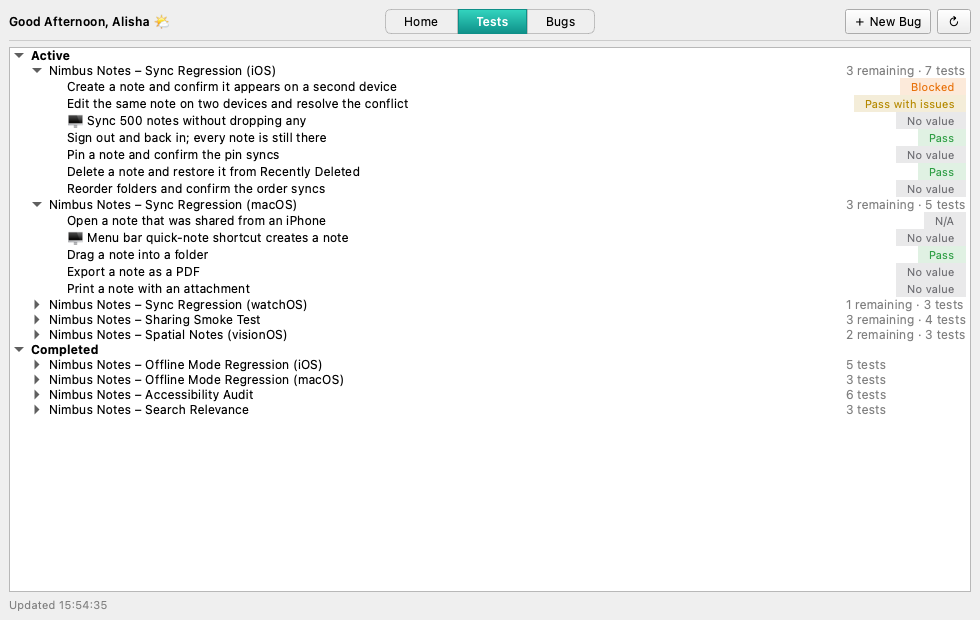

# TaskBoard

A desktop app that helps a tester decide what to test next. It lists the test runs and bugs
assigned to you, picks the five most important unrun test cases, and tracks your progress as
you work through them. Built with Python and PySide6 (Qt).

This repo ships with a made-up data set for a fictional notes app, "Nimbus Notes", so you can
try everything without connecting to anything.

## What it does

- **Get Started** shows five unrun test cases at a time. Record a result and the row gets a
  status badge. Once all five have one, **Continue** brings up the next five, and the progress
  bar at the bottom shows how much of your work is done.
- **Tests** lists your test runs, split into Active and Completed, newest first. Each expands
  to your test cases and their statuses.
- **Bugs** lists bugs waiting on your verification.
- A loading screen with a real progress bar, a Retry flow that tells you it's retrying, and a
  background thread so the window never freezes while data loads.

| Progress and results | Everything you have to run |
|---|---|
|  |  |

## Try it

You need macOS and Python 3.9 or newer.

    git clone <this repo> && cd TaskBoard
    ./setup.sh

Then double-click **TaskBoard.app**, or run `.venv/bin/python -m taskboard`.

The demo acts like a tracker you can write to: **click a test case** (on Home or Tests) and pick
a result. Watch the badge appear, the progress bar move, and Continue show up after the fifth.

Keep `TaskBoard.app` inside the project folder, since it finds the code relative to itself
(drag it to the Dock, or make an alias, rather than copying it elsewhere). If macOS warns about
an unidentified developer after a download, right-click the app and choose Open once.

## How it picks what to test next

Unrun cases are ranked by, in order:

1. **Priority**: 1 first, then 2, and so on, until nothing is left.
2. **Manual before automatable**: a 🖥️ in a case title marks one that can be automated, which
   matters less than one only a person can do.
3. **Device**: watchOS, then iOS, macOS and visionOS. The device is read from the case title,
   then the run's title, then the case instructions. A case naming several devices counts as
   the most important one.
4. **Recency**: cases from newer runs come first, then by their order inside the run.

A batch of five stays put while you work through it, so rows don't jump around. `get_started.py`
holds the ranking and `devices.py` the device detection.

## How it's put together

    taskboard/
      models.py       Bug, TestCase, TestRun: plain frozen dataclasses
      demo.py         DemoSource: the fictional data, and a place to record results
      worker.py       SyncWorker: a QThread that polls a source and emits Qt signals
      get_started.py  ranking and batching
      devices.py      reads a device out of text
      ui.py           the window: tabs, lists, badges, progress bars
    tools/make_icon.py  draws the app icon with QPainter

- **The UI never talks to the data source.** `SyncWorker` does, on its own thread, and hands
  results over through signals. Views compare new data with what they show and only redraw when
  it changed, so expanded rows and scroll position survive refreshes.
- **The source is an interface, not a class.** Anything with `fetch_bugs(progress)` and
  `fetch_test_runs(progress)` returning the models above will work, so `DemoSource` can be
  replaced with a client for a real tracker. `progress(fraction, text)` drives the loading bar.
- **Syncs are cheap.** A real source can keep finished runs cached and only re-read active ones,
  which is how the original version got from minutes per sync down to a few seconds.

## Customising the look

The turquoise comes from two constants at the top of `ui.py` (`TEAL_TOP`, `TEAL_BOTTOM`). To
redraw the icon with different colours, edit `tools/make_icon.py` and run
`.venv/bin/python tools/make_icon.py`.
